# ชุดสไลด์นำเสนอ: ถอดรหัสเบื้องหลังการรับเลี้ยงสุนัข ทำไม 1 ใน 7 ตัวถึงถูกส่งคืน?
## การวิเคราะห์ปัจจัยความสำเร็จและสาเหตุความล้มเหลวของการรับเลี้ยงสุนัข 42,000 เคส
*(Based on data & analysis from visualization.ipynb)*

---

### สารบัญสไลด์ (Slide Directory)
- **Slide 1**: หน้าปก - ถอดรหัสเบื้องหลังการรับเลี้ยงสุนัข: ทำไม 1 ใน 7 ตัวถึงถูกส่งคืน?
- **Slide 2**: ภาพรวมผู้บริหาร - สถิติ 42,000 เคส: สำเร็จ 85% แต่มีช่องว่างความสูญเสีย 15%
- **Slide 3**: เจาะลึก 9 สาเหตุแห่งความล้มเหลว - พฤติกรรมและความขัดแย้งครองสัดส่วน >71%
- **Slide 4**: สัปดาห์ชี้ชะตา (The Critical 7-Day Window) - มัธยฐาน 7 วัน และระยะเวลาปะทุของแต่ละปัญหา
- **Slide 5**: พฤติกรรมเสี่ยงสะสม (Behaviour Burden) - กฎการทวีคูณความเสี่ยง (9.2% สู่ 40.2%)
- **Slide 6**: วัคซีนแก้ปัญหาพฤติกรรม (Training as the Antidote) - การฝึกอบรมลดการส่งคืนได้ถึง 17.5 pp
- **Slide 7**: ความไม่ลงรอยของไลฟ์สไตล์ (Lifestyle & Space Mismatch) - พลังงาน เวลา และขนาดที่พัก
- **Slide 8**: มายาคติเรื่องประสบการณ์ (Expectations Beat Experience) - ความคาดหวังสำคัญกว่ามือเก่าหรือมือใหม่
- **Slide 9**: พลังของการเตรียมตัว (Preparation Power) - เยี่ยมชม 4 ครั้ง ลดอัตราส่งคืนเหลือ 10.9%
- **Slide 10**: สรุปทอร์นาโดปัจจัยเสี่ยง vs ปัจจัยปกป้อง (Correlation & Risk Tornado)
- **Slide 11**: ยุทธศาสตร์ 3 ระยะเพื่อหยุดการส่งคืน (3-Phase Strategic Recommendations)
- **Slide 12**: บทสรุปและประเด็นปิดท้าย (Conclusion & Takeaways)
- **Slide 13**: หน้าสรุปผลการวิเคราะห์และข้อเสนอแนะ (Executive Summary Dashboard)

---

## Slide 1: หน้าปกการนำเสนอ (Title Slide)
- **หัวข้อหลัก**: ถอดรหัสเบื้องหลังการรับเลี้ยงสุนัข: ทำไม 1 ใน 7 ตัวถึงถูกส่งคืน?
- **หัวข้อย่อย**: การวิเคราะห์ข้อมูลเชิงลึก 42,000 เคส เพื่อค้นหาสาเหตุและแนวทางยกระดับความสำเร็จในการรับเลี้ยงสุนัขอย่างยั่งยืน
- **ภาพประกอบ**:

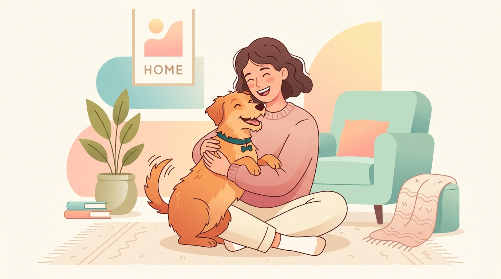
- **ประเด็นหลัก**: การรับเลี้ยงสุนัขไม่ใช่แค่เรื่องของความเมตตา แต่คือ "วิทยาศาสตร์แห่งการจับคู่ที่ลงตัว (The Science of Matching)"

> **บทพูดผู้บรรยาย (Speaker Script)**:  
> "สวัสดีทุกท่านครับ วันนี้เราจะมาร่วมกันเปิดมุมมองใหม่เกี่ยวกับการรับเลี้ยงสุนัขผ่านชุดข้อมูลขนาดใหญ่ 42,000 เคส หลายคนมักเข้าใจว่าเมื่อสุนัขได้บ้านใหม่แล้วเรื่องราวจะจบลงอย่างมีความสุข แต่ข้อมูลเชิงประจักษ์บอกเราว่า '1 ใน 7 ตัว' ต้องถูกส่งคืนกลับมายังสถานสงเคราะห์ วันนี้เราจะมาเจาะลึกกันว่า อะไรคือสาเหตุที่แท้จริง และเราจะเปลี่ยนความล้มเหลวนี้ให้เป็นความสำเร็จที่ยั่งยืนได้อย่างไรครับ"

---

## Slide 2: ภาพรวมผลลัพธ์ (Executive Summary)
- **หัวข้อ**: ภาพรวม 42,000 เคส: สำเร็จ 85% แต่มีช่องว่างความสูญเสีย 15%
- **ข้อมูลสำคัญ**:
  - **กลุ่มตัวอย่าง**: 42,000 เคสการรับเลี้ยงสุนัข
  - **อัตราความสำเร็จ (Stayed Home / Kept)**: **85.0%** (35,703 ตัว)
  - **อัตราการส่งคืน (Returned to Shelter)**: **15.0%** (6,297 ตัว)
  - **อัตราส่วนเทียบเคียง**: ราว 1 ในทุกๆ 7 ตัวของการรับเลี้ยงจะล้มเหลว
- **ภาพกราฟประกอบ**:

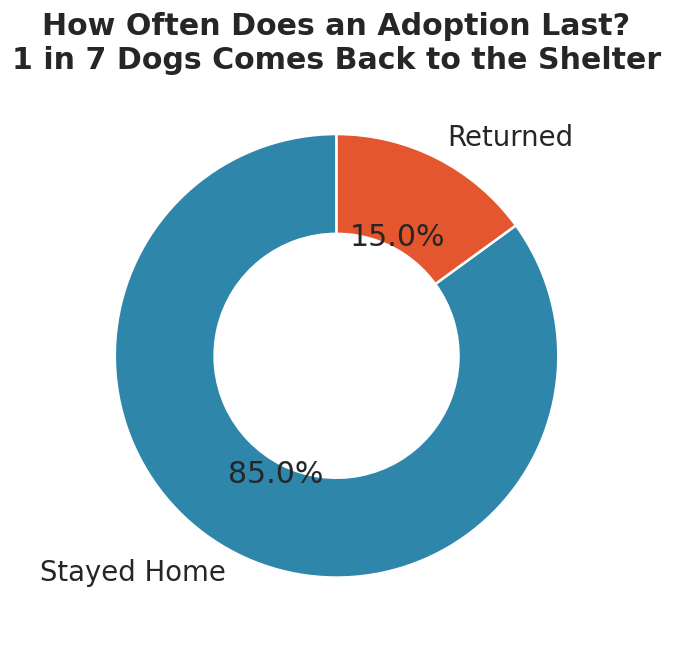
*แผนภูมิแสดงสัดส่วนผลลัพธ์การรับเลี้ยง: อยู่บ้านถาวร 85.0% vs ส่งคืนสถานสงเคราะห์ 15.0%*
- **สาระสำคัญ**:
  - อัตราความสำเร็จ 85% ถือเป็นตัวเลขที่ดีในระดับสากล
  - ทว่าจำนวน 6,297 ตัวที่ถูกส่งคืน สร้างบาดแผลทางจิตใจให้ทั้งตัวสุนัขและครอบครัวผู้รับเลี้ยง อีกทั้งยังเพิ่มภาระงบประมาณและพื้นที่ของสถานสงเคราะห์ซ้ำซ้อน

> **บทพูดผู้บรรยาย (Speaker Script)**:  
> "จากข้อมูล 42,000 เคส เราพบว่า 85% หรือราว 35,700 ตัวสามารถปรับตัวและอยู่กับครอบครัวใหม่ได้อย่างถาวร นี่คือความสำเร็จที่น่าชื่นชม แต่ในทางกลับกัน ตัวเลข 15% หรือ 6,297 ตัวที่ถูกส่งคืน ไม่ใช่แค่สถิติธรรมดา เพราะการถูกส่งคืนหนึ่งครั้งหมายถึงความบอบช้ำทางจิตใจของสุนัข ความผิดหวังของครอบครัว และทรัพยากรของสถานสงเคราะห์ที่ต้องวนกลับมาดูแลซ้ำ คำถามสำคัญคือ 6,297 เคสนี้ เกิดอะไรขึ้นกันแน่?"

---

## Slide 3: เจาะลึก 9 สาเหตุแห่งความล้มเหลว (Top 9 Return Reasons)
- **หัวข้อ**: ทำไมการรับเลี้ยงถึงล้มเหลว? พฤติกรรมและความขัดแย้งครองสัดส่วน >71%
- **ตารางสถิติสาเหตุการส่งคืน (จาก 6,297 ตัว)**:

| อันดับ | สาเหตุการส่งคืน (Return Reason) | จำนวน (ตัว) | สัดส่วน (%) | หมวดหมู่ |
| :---: | :--- | :---: | :---: | :---: |
| 1 | **เข้ากับสัตว์เลี้ยงเดิมในบ้านไม่ได้** (Conflict With Resident Pets) | **1,387** | **22.0%** | พฤติกรรม/ความสัมพันธ์ |
| 2 | **พฤติกรรมก้าวร้าว/ดุร้าย** (Aggression) | **1,352** | **21.5%** | พฤติกรรม |
| 3 | **วิตกกังวลจากการแยกจาก/ทำลายของ** (Separation Anxiety) | **975** | **15.5%** | พฤติกรรม |
| 4 | **ความคาดหวังไม่ตรงกับความจริง** (Unmet Expectations) | **750** | **11.9%** | การเตรียมตัว/ทัศนคติ |
| 5 | ปัญหาที่พักอาศัย/เจ้าของห้ามเลี้ยง (Housing Landlord) | 535 | 8.5% | สิ่งแวดล้อมภายนอก |
| 6 | ภาระค่าใช้จ่ายและเวลา (Cost & Time) | 512 | 8.1% | ทรัพยากรผู้รับเลี้ยง |
| 7 | ปัญหาสุขภาพของสุนัข (Medical Needs) | 316 | 5.0% | สุขภาพ |
| 8 | ภูมิแพ้ขนสุนัข (Allergies) | 238 | 3.8% | สุขภาพผู้รับเลี้ยง |
| 9 | สาเหตุอื่นๆ (Other) | 232 | 3.7% | อื่นๆ |

- **ภาพกราฟประกอบ**:

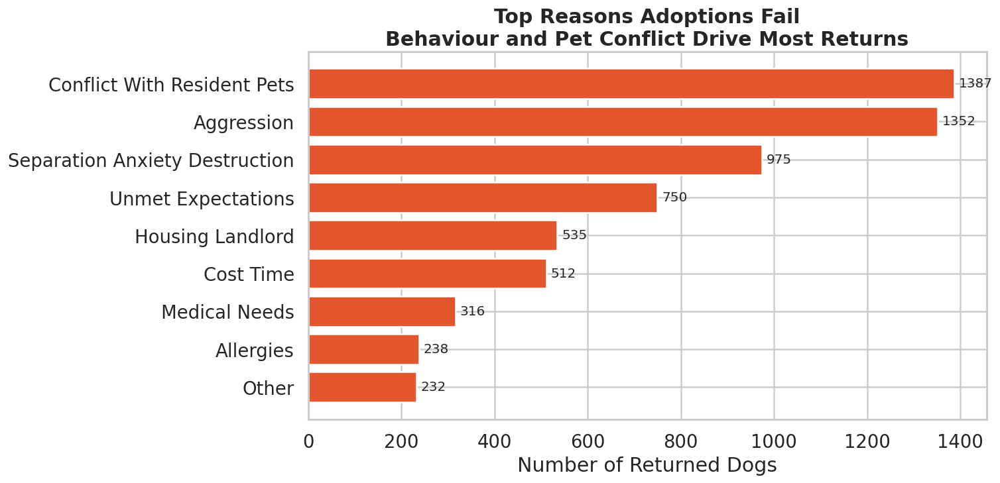
*แผนภูมิแจกแจง 9 สาเหตุหลักของการส่งคืนสุนัข*
- **ข้อค้นพบสำคัญ (Key Insight)**:
  - สาเหตุอันดับ 1 ถึง 4 รวมกันสูงถึง **4,464 ตัว หรือคิดเป็น 70.9%** ล้วนเกี่ยวข้องกับ "พฤติกรรมสุนัข" และ "ความสัมพันธ์/ความคาดหวัง"
  - สาเหตุที่คนมักกลัว เช่น อาการแพ้ขน (Allergies 3.8%) หรือโรคประจำตัว (Medical Needs 5.0%) กลับเป็นสัดส่วนที่น้อยมาก

> **บทพูดผู้บรรยาย (Speaker Script)**:  
> "เมื่อเราแจกแจงสาเหตุของการส่งคืน 6,297 เคส ผลลัพธ์ที่ได้น่าประหลาดใจมากครับ หลายคนคิดว่าคนส่งหมาคืนเพราะแพ้ขนหรือหมาป่วย แต่ตัวเลขจริงชี้ว่า อาการแพ้มีแค่ 3.8% และปัญหาสุขภาพมีแค่ 5% เท่านั้น แต่กว่า 71% เกิดจาก 4 เรื่องหลัก: อันดับหนึ่งคือ 'เข้ากับสัตว์เลี้ยงเดิมในบ้านไม่ได้' (22%), อันดับสอง 'ความดุร้ายก้าวร้าว' (21.5%), อันดับสาม 'วิตกกังวลเมื่ออยู่เดี่ยวจนทำลายบ้าน' (15.5%), และอันดับสี่ 'ไม่เป็นไปตามที่คาดหวัง' (11.9%) นี่คือหลักฐานชัดเจนว่า ความล้มเหลวส่วนใหญ่เป็นเรื่องของพฤติกรรมและการปรับตัวครับ"

---

## Slide 4: สัปดาห์ชี้ชะตา (The Critical Window)
- **หัวข้อ**: 7 วันแรกคือสัปดาห์ชี้ชะตา (Median Days to Return = 7 วัน)
- **ข้อมูลและไทม์ไลน์**:
  - **ค่ามัธยฐาน (Median)**: **7 วัน** (ครึ่งหนึ่งของการส่งคืนเกิดขึ้นภายในสัปดาห์แรก!)
  - **การกระจายตัว**: ยอดการส่งคืนพุ่งสูงสุด (Spike) ระหว่างวันที่ 1 ถึง 14 วันแรก แล้วค่อยๆ ลดลงตามเวลา
- **พฤติกรรมของปัญหาตามไทม์ไลน์ (Timeline Breakdown)**:
  - **ปัญหาปะทุทันที (Days 1–14)**:
    - *Aggression (ความก้าวร้าว)*: มัธยฐาน ~5-7 วัน แสดงออกทันทีที่ถึงบ้านใหม่
    - *Conflict With Resident Pets (ทะเลาะกับตัวเดิม)*: แสดงอาการตั้งแต่วันแรกที่เผชิญหน้า
    - *Separation Anxiety (ทำลายข้าวของ)*: เกิดขึ้นทันทีที่เจ้าของออกไปทำงานวันแรกๆ
    - *Medical Needs (อาการป่วย)*: ตรวจพบและส่งคืนในสัปดาห์แรก
  - **ปัญหาที่ค่อยๆ สะสม (Weeks to Months)**:
    - *Housing Landlord (ปัญหานิติ/หอพัก)*: เฉลี่ย 20-50 วัน (หลังนิติตรวจพบหรือเพื่อนบ้านร้องเรียน)
    - *Unmet Expectations & Cost/Time (ความเหนื่อยล้าและภาระค่าใช้จ่าย)*: ค่อยๆ สะสมและส่งคืนในเดือนที่ 1–3
- **ภาพกราฟประกอบ**:

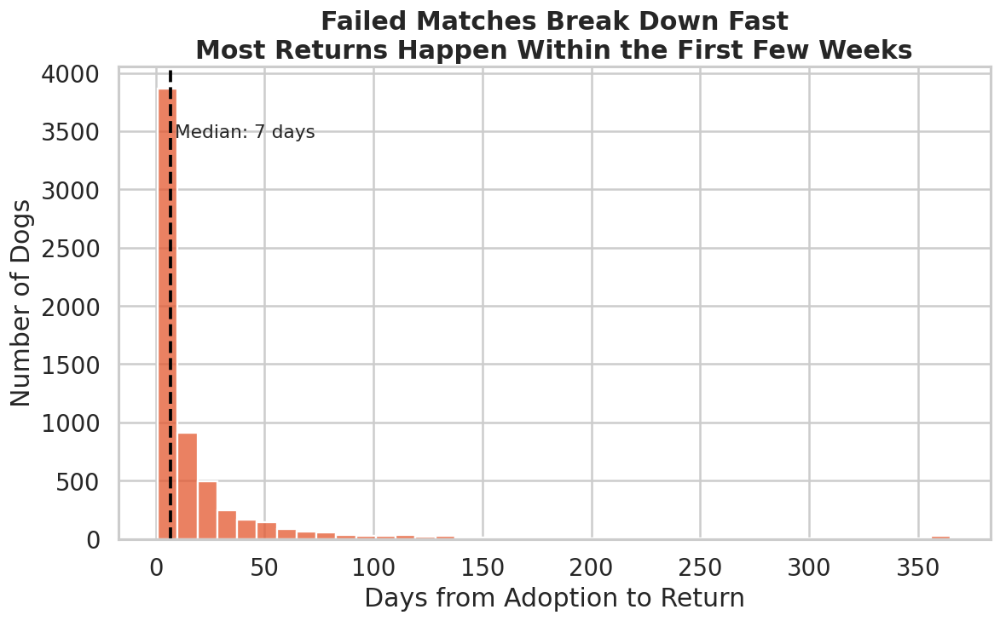
*การกระจายตัวของจำนวนวันที่สุนัขถูกส่งคืน (มัธยฐาน 7 วัน)*

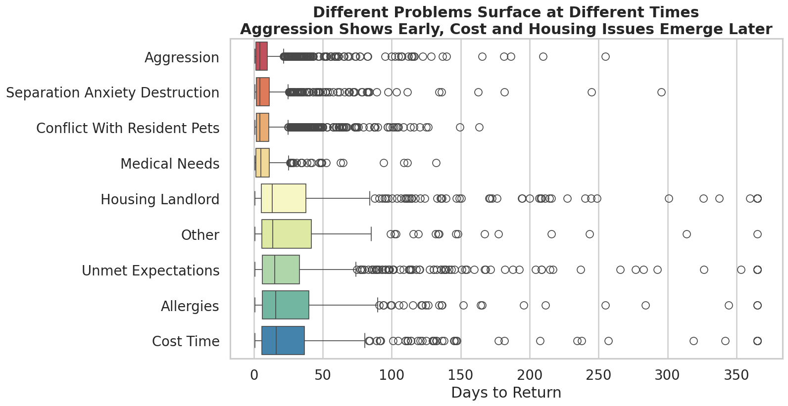
*การกระจายตัวของระยะเวลาตามประเภทสาเหตุ (ปัญหาพฤติกรรมปะทุใน 1-14 วันแรก)*

> **บทพูดผู้บรรยาย (Speaker Script)**:  
> "สไลด์นี้คือข้อมูลชี้เป็นชี้ตายของการจัดการครับ สถิติระบุว่า ค่ามัธยฐานของการส่งคืนอยู่ที่ '7 วัน' เท่านั้น แปลว่าถ้าการรับเลี้ยงจะพัง มันมักจะพังตั้งแต่อาทิตย์แรก! และเมื่อเราดูตามประเภทปัญหา จะเห็นการแบ่งกลุ่มที่ชัดเจนมาก ปัญหาความก้าวร้าว การกัดกันกับหมาเดิม และอาการเห่าหอนทำลายของจะปะทุทันทีในสัปดาห์แรก ส่วนปัญหาเรื่องค่าใช้จ่ายหรือนิติบุคคลจะตามมาในเดือนที่ 2 หรือ 3 ดังนั้น '14 วันแรก' จึงเป็นหน้าต่างเวลาทอง (Golden Window) ที่สถานสงเคราะห์ต้องมีระบบติดตามและช่วยเหลือผู้รับเลี้ยงอย่างใกล้ชิดครับ"

---

## Slide 5: พฤติกรรมเสี่ยงสะสม (Behaviour Burden)
- **หัวข้อ**: ปัญหาพฤติกรรมไม่เคยมาเดี่ยว: กฎการทวีคูณความเสี่ยง (9.2% สู่ 40.2%)
- **การวิเคราะห์คะแนนพฤติกรรม 3 ด้านหลัก (คะแนน >= 5 จาก 10)**:
  - ความก้าวร้าว (Aggression)
  - ความวิตกกังวลจากการแยกจาก (Separation Anxiety)
  - ปฏิกิริยาก้าวร้าวต่อสุนัขตัวอื่น (Reactivity to Dogs)
- **อัตราการส่งคืนตามจำนวนพฤติกรรมเสี่ยง (Behaviour Burden)**:

| จำนวนพฤติกรรมเสี่ยง (Flags) | อัตราการส่งคืน (%) | อัตราสำเร็จ (%) | จำนวนสุนัขในกลุ่ม (ตัว) | การประเมินความเสี่ยง |
| :---: | :---: | :---: | :---: | :---: |
| **0 ปัญหา (None)** | **9.2%** | **90.8%** | 19,620 | ปลอดภัยสูงมาก |
| **1 ปัญหา (Single)** | **16.5%** | **83.5%** | 15,945 | ความเสี่ยงปานกลาง (ใกล้ค่าเฉลี่ย) |
| **2 ปัญหา (Dual)** | **27.0%** | **73.0%** | 5,562 | ความเสี่ยงสูง (ส่งคืน 1 ใน 4) |
| **3 ปัญหาพร้อมกัน (Triple)** | **40.2%** | **59.8%** | 873 | วิกฤต (ส่งคืนเกือบครึ่งหนึ่ง!) |

- **ภาพกราฟประกอบ**:

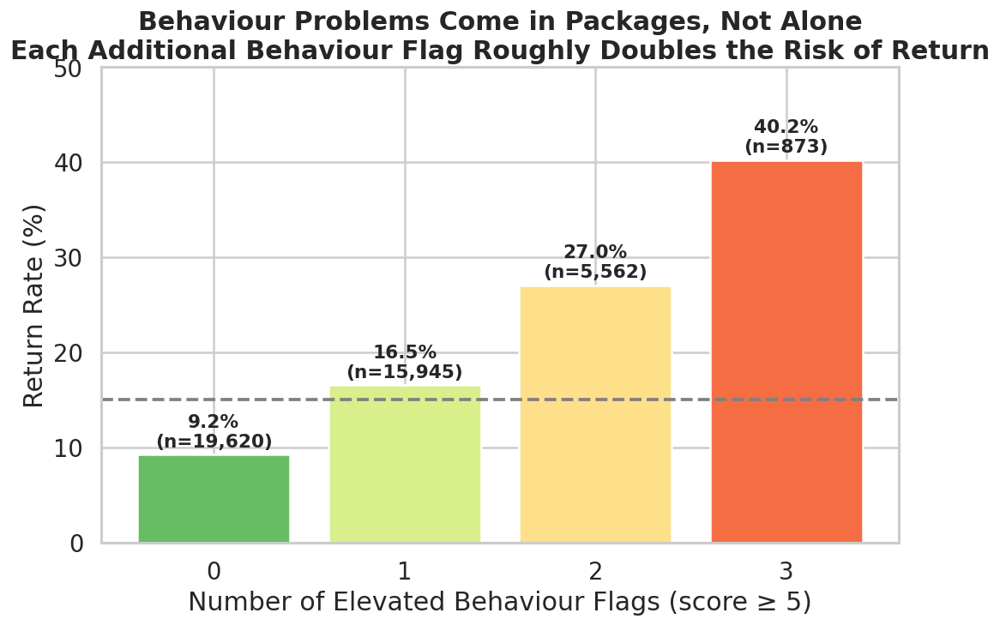
*อัตราการส่งคืนพุ่งสูงขึ้นตามจำนวนพฤติกรรมเสี่ยงสะสม (9.2% -> 16.5% -> 27.0% -> 40.2%)* และ `assets/charts/03_behaviour_profile.png`
- **สรุปสาระ**: ทุกๆ 1 ปัญหาพฤติกรรมที่เพิ่มขึ้น ความเสี่ยงในการถูกส่งคืนจะเพิ่มขึ้นเกือบ 1 เท่าตัว (Doubling Effect)

> **บทพูดผู้บรรยาย (Speaker Script)**:  
> "เรามาดูเรื่องพฤติกรรมกันชัดๆ ครับ กราฟนี้แสดง 'Behaviour Burden' หรือภาระพฤติกรรมสะสม ถ้าสุนัขไม่มีปัญหาพฤติกรรมรุนแรงเลย อัตราการส่งคืนจะต่ำมากเพียง 9.2% หรือสำเร็จถึง 91% แต่เมื่อมีพฤติกรรมเสี่ยง 1 อย่าง อัตราส่งคืนขยับเป็น 16.5% ถ้ามี 2 อย่างกระโดดไปที่ 27% และถ้ามีทั้งดุ ขี้กังวล และก้าวร้าวต่อหมาอื่นพร้อมกัน อัตราส่งคืนจะพุ่งแตะ 40.2%! หมากลุ่มนี้ 10 ตัว จะถูกส่งคืนถึง 4 ตัว ปัญหาพฤติกรรมจึงเปรียบเหมือนตัวคูณความเสี่ยงที่เราต้องคัดกรองตั้งแต่ก่อนส่งมอบครับ"

---

## Slide 6: วัคซีนแก้ปัญหาพฤติกรรม (Training as the Antidote)
- **หัวข้อ**: การฝึกสุนัขคือยาวิเศษ: ลดอัตราการส่งคืนในกลุ่มเสี่ยงสูงลงถึง 17.5 pp
- **ผลการวิเคราะห์ไขว้ระหว่าง "ความดุร้าย (Aggression)" และ "ระดับการฝึก (Training Level)"**:

| ระดับความดุร้าย (Aggression) | ไม่ได้รับการฝึก (Low Training) | ฝึกระดับกลาง (Mid Training) | ฝึกระดับสูง (High Training) | ผลลัพธ์จากการฝึก |
| :--- | :---: | :---: | :---: | :---: |
| **ดุร้ายสูง (High)** | **47.1%** | **37.2%** | **29.6%** | **ลดลง 17.5 pp (เกือบครึ่ง!)** |
| **ปานกลาง (Mid)** | **29.2%** | **21.3%** | **15.0%** | **ลดลง 14.2 pp** |
| **ไม่ดุร้าย (Low)** | **15.6%** | **9.9%** | **6.7%** | **ลดลงเหลือเพียง 6.7%** |

- **ภาพกราฟประกอบ**:

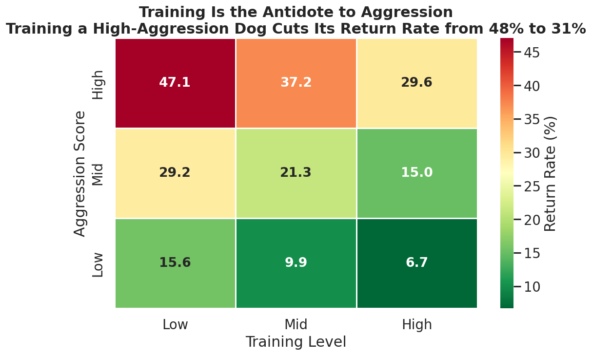
*Heatmap ผลของการฝึกสุนัขต่อการลดอัตราการส่งคืนในสุนัขแต่ละระดับความดุร้าย* (Heatmap Matrix)
- **ข้อค้นพบเปลี่ยนเกม (Game-Changing Insight)**:
  - สุนัขที่ดุแต่ไม่เคยฝึก มีโอกาสถูกส่งคืนเกือบครึ่งหนึ่ง (47.1%)
  - แต่หากนำสุนัขตัวเดิมไปผ่านการฝึกอบรมระดับสูง อัตราการส่งคืนจะลดลงเหลือเพียง **29.6%**
  - และหากเป็นสุนัขนิสัยดีและผ่านการฝึก สุนัขกลุ่มนี้จะมีอัตราสำเร็จสูงถึง **93.3% (ส่งคืนแค่ 6.7%)**
  - **สรุป**: "ความดุร้ายไม่ใช่ตราบาปถาวร" เพราะการฝึก (Training) สามารถบรรเทาความเสี่ยงได้จริงอย่างมีนัยสำคัญ

> **บทพูดผู้บรรยาย (Speaker Script)**:  
> "ข่าวดีที่สุดจากข้อมูลชุดนี้คือ 'เราแก้ไขมันได้' ครับ สไลด์นี้พิสูจน์ว่า 'การฝึกสุนัขคือยาวิเศษ' ดูช่องซ้ายบนครับ สุนัขที่มีนิสัยดุร้ายและไม่ได้รับการฝึก จะถูกส่งคืนสูงถึง 47.1% แทบจะโยนเหรียญหัวก้อย แต่เมื่อสุนัขดุกลุ่มเดียวกันนี้ได้รับการฝึกฝน อัตราส่งคืนจะลดลงเหลือ 37.2% และ 29.6% ตามลำดับ ลดลงไปถึง 17.5% ส่วนสุนัขที่ไม่ดุและฝึกมาดี อัตราส่งคืนเหลือเพียง 6.7% เท่านั้น นั่นหมายความว่า หากสถานสงเคราะห์ลงทุนกับการฝึกพฤติกรรมพื้นฐานก่อนส่งมอบ จะช่วยชีวิตสุนัขจากการถูกส่งคืนได้มหาศาลครับ"

---

## Slide 7: ความไม่ลงรอยของไลฟ์สไตล์ (Lifestyle & Space Mismatch)
- **หัวข้อ**: ความไม่ลงรอยของไลฟ์สไตล์: เมื่อสิ่งแวดล้อมไม่เหมาะกับสุนัข
- **3 ปัจจัย Mismatch สำคัญ**:
  1. **Energy Mismatch (พลังงานสุนัข vs กิจกรรมเจ้าของ)**:
     - Mismatch 0–1 (ไลฟ์สไตล์ตรงกัน): ส่งคืน **11.5%**
     - Mismatch 2–3: ส่งคืน **15.1%**
     - Mismatch 4+ (หมาพลังงานสูงมาก แต่อยู่กับคนไม่ออกกำลังกาย): ส่งคืนพุ่งสูงถึง **21.2%** (เพิ่มเกือบเท่าตัว!)
  2. **Hours Left Alone (ชั่วโมงที่ปล่อยให้อยู่ลำพังต่อวัน)**:
     - 0–2 ชม./วัน: ส่งคืน **11.6%**
     - 4–6 ชม./วัน: ส่งคืน **14.3%**
     - 8+ ชม./วัน: ส่งคืนพุ่งเป็น **17.5%** (กระตุ้นให้อาการเห่าและทำลายของกำเริบ)
  3. **Size-Home Mismatch (ขนาดตัว vs ประเภทที่พัก)**:
     - สุนัขพันธุ์ใหญ่ (Large) ในอพาร์ตเมนต์: ส่งคืนสูงถึง **19.5%**
     - สุนัขพันธุ์ยักษ์ (X-Large) ในอพาร์ตเมนต์: ส่งคืน **18.6%**
     - เทียบกับบ้านเดี่ยวมีรั้ว (House Owned): ส่งคืนเพียง **12.1% – 14.4%**
- **ภาพกราฟประกอบ**:

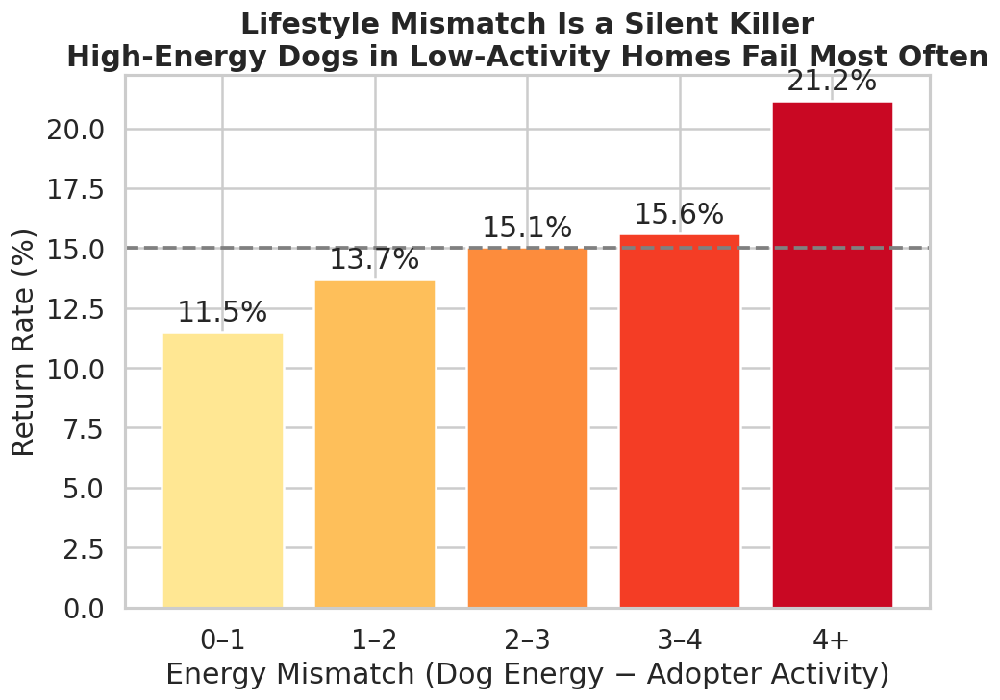
*อัตราการส่งคืนตามระดับความไม่ลงรอยของพลังงาน (Energy Mismatch)*

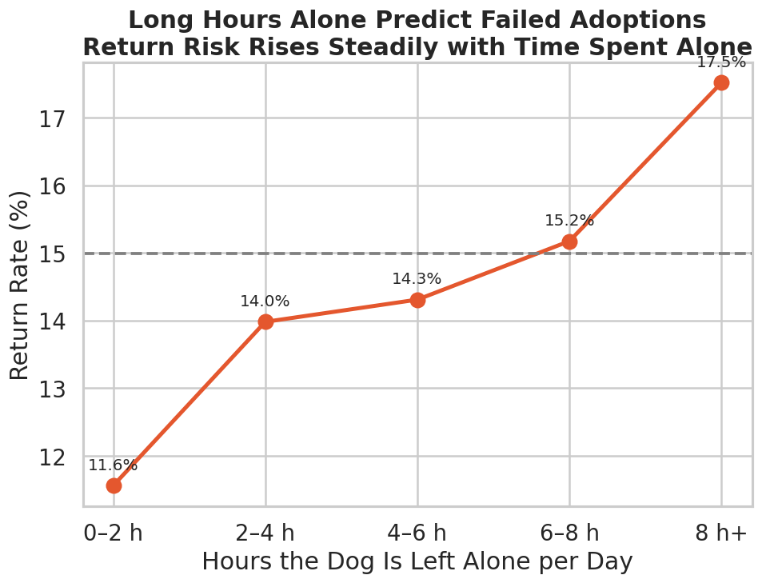
*ผลกระทบของการปล่อยสุนัขให้อยู่ลำพัง*

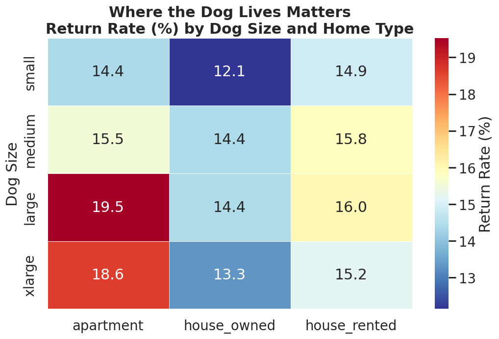
*การจับคู่ขนาดตัวกับประเภทที่พักอาศัย*

> **บทพูดผู้บรรยาย (Speaker Script)**:  
> "นอกจากนิสัยสุนัขแล้ว ความเข้ากันได้ของวิถีชีวิตหรือ Lifestyle Matching คือตัวแปรสำคัญครับ กราฟชี้ชัดว่า หากสุนัขพลังงานสูงไปอยู่กับเจ้าของที่ไม่มีเวลาพาไปออกกำลังกาย (Energy Mismatch สูง) อัตราส่งคืนจะพุ่งจาก 11.5% ไปเป็น 21.2% ทันที เช่นเดียวกับการปล่อยสุนัขทิ้งไว้ลำพังเกิน 8 ชั่วโมงต่อวัน อัตราส่งคืนก็แตะ 17.5% และโดยเฉพาะการนำสุนัขตัวใหญ่ไปเลี้ยงในอพาร์ตเมนต์แคบๆ อัตราส่งคืนสูงเกือบ 20% ดังนั้นการคัดเลือกสุนัขให้ตรงกับสภาพความเป็นอยู่จริงของบ้าน จึงเป็นเกราะป้องกันการส่งคืนที่ดีที่สุดครับ"

---

## Slide 8: มายาคติเรื่องประสบการณ์ (Expectations Beat Experience)
- **หัวข้อ**: ความคาดหวังสำคัญกว่าประสบการณ์: มือใหม่ที่มองโลกตามจริงเอาชนะมือเก๋า
- **การเปรียบเทียบระหว่าง "ระดับความคาดหวัง (Expectations)" กับ "ประสบการณ์เลี้ยงสุนัข (First-Time vs Experienced)"**:

| ระดับความคาดหวัง (Expectation Score) | คนเคยเลี้ยงสุนัข (Experienced) | มือใหม่หัดเลี้ยง (First-Time Owner) | ช่องว่าง (Gap) |
| :--- | :---: | :---: | :---: |
| **คาดหวังตามจริง (Realistic)** | **8.3%** | **9.4%** | +1.1 pp (ต่ำมากทั้งคู่!) |
| **คาดหวังปานกลาง (Moderate)** | **12.2%** | **15.0%** | +2.8 pp |
| **คาดหวังเกินจริง (Unrealistic)** | **16.6%** | **20.9%** | +4.3 pp (ล้มเหลวสูง) |

- **ภาพกราฟประกอบ**:

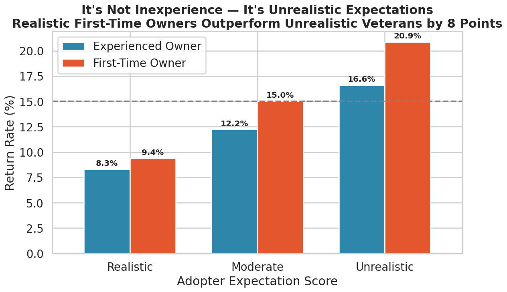
*อัตราการส่งคืนเปรียบเทียบระหว่างความคาดหวังและประสบการณ์* (Grouped Bar Chart)
- **ข้อสรุปที่พลิกความเชื่อเดิม**:
  - สังคมมักเชื่อว่า "ต้องให้คนมีประสบการณ์เลี้ยงก่อน ถึงจะไม่คืนหมา"
  - แต่ข้อมูลพิสูจน์ว่า: **มือใหม่ที่คาดหวังตามความเป็นจริง (ส่งคืน 9.4%) มีผลลัพธ์ที่ดีกว่าคนเคยเลี้ยงแต่คาดหวังเกินจริง (ส่งคืน 16.6%) ถึงเกือบ 8 percentage points!**
  - ปัญหาไม่ได้อยู่ที่ 'ไม่เคยเลี้ยง' แต่อยู่ที่ 'คิดว่าหมาจะแสนรู้และสมบูรณ์แบบตั้งแต่วันแรก'

> **บทพูดผู้บรรยาย (Speaker Script)**:  
> "นี่คือหนึ่งในสไลด์ที่ทรงพลังที่สุดของการศึกษานี้ครับ เรามักมีอคติว่า 'ผู้รับเลี้ยงมือใหม่' มีความเสี่ยงสูง แต่ตัวเลขบอกความจริงที่ตรงกันข้ามเลยครับ ถ้าผู้รับเลี้ยงมือใหม่มีความคาดหวังที่สมจริง รู้ว่าหมาอาจมีฉี่ผิดที่ อาจมีตื่นกลัวช่วงแรก อัตราส่งคืนจะต่ำมากเพียง 9.4% ซึ่งชนะคนมีประสบการณ์แต่คาดหวังว่าหมาต้องเพอร์เฟกต์ ที่มีอัตราส่งคืนถึง 16.6%! สิ่งนี้บอกเราว่า การปรับทัศนคติและความคาดหวังของผู้รับเลี้ยงให้ตรงกับความเป็นจริง สำคัญกว่าประวัติการเลี้ยงดูในอดีตอย่างสิ้นเชิงครับ"

---

## Slide 9: พลังของการเตรียมความพร้อม (Preparation Power)
- **หัวข้อ**: การเตรียมความพร้อมก่อนรับเลี้ยง: ยิ่งมาเยี่ยมบ่อย ยิ่งจับคู่ได้แม่นยำ
- **หลักฐานเชิงประจักษ์จากการเตรียมตัว**:
  1. **จำนวนครั้งที่มาเยี่ยมชมก่อนรับเลี้ยง (Visits Before Adoption)**:
     - เยี่ยม 1 ครั้ง (รีบรับกลับ): อัตราส่งคืน **16.6%**
     - เยี่ยม 2 ครั้ง: อัตราส่งคืน **14.1%**
     - เยี่ยม 3 ครั้ง: อัตราส่งคืน **12.7%**
     - **เยี่ยม 4 ครั้งขึ้นไป: อัตราส่งคืนลดฮวบเหลือเพียง 10.9%! (ลดลงถึง 5.7 pp)**
  2. **การเข้ารับคำปรึกษา (Adoption Counselling)**:
     - ไม่ได้รับคำปรึกษา: ส่งคืน **15.9%**
     - ได้รับคำปรึกษาล่วงหน้า: ส่งคืน **13.2%** (ลดลง 2.7 pp)
  3. **การพาสัตว์เลี้ยงเดิมมาทดลองพบกันก่อน (Meet & Greet)**:
     - ช่วยลดความเสี่ยงข้อที่ 1 (Conflict with Resident Pets) ได้โดยตรง
- **ภาพกราฟประกอบ**:

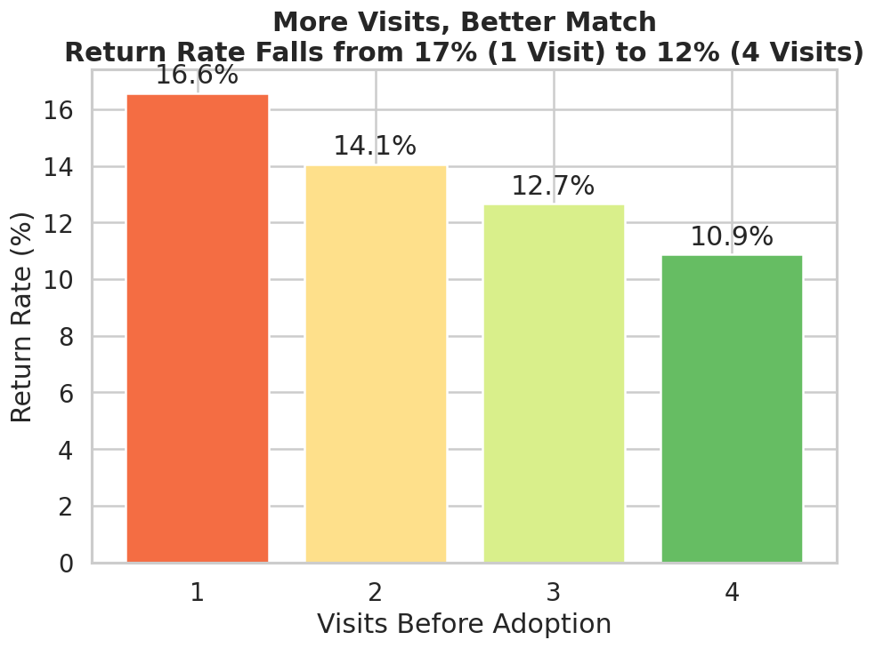
*อัตราการส่งคืนลดลงต่อเนื่องตามจำนวนครั้งที่มาเยี่ยมชม (16.6% -> 10.9%)*

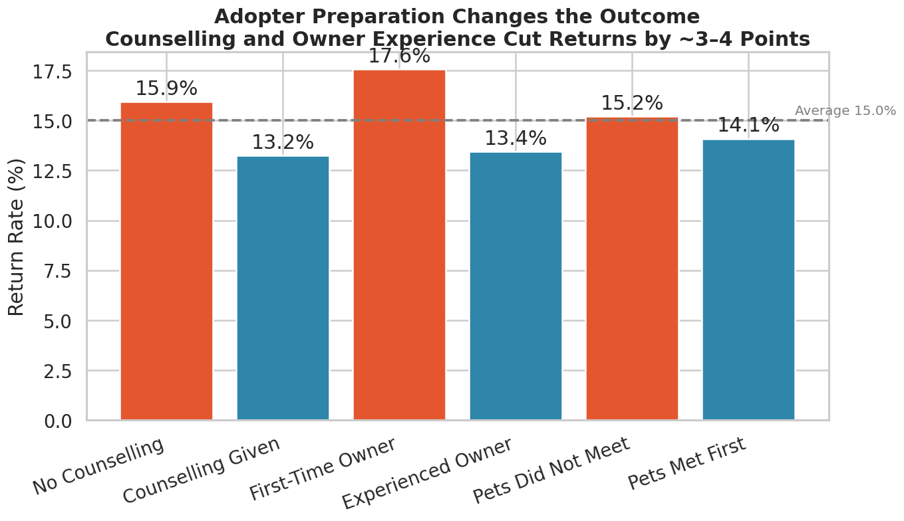
*ผลของการเตรียมความพร้อมและปรับความคาดหวัง*

> **บทพูดผู้บรรยาย (Speaker Script)**:  
> "เมื่อเห็นแล้วว่าการเตรียมตัวสำคัญ ข้อมูลชี้ให้เห็นวิธีการแก้ปัญหาที่ชัดเจนมากครับ ดูสถิติการมาเยี่ยมสุนัขก่อนรับเลี้ยง: คนที่มาดูวันเดียวแล้วรับกลับทันที มีอัตราส่งคืนสูงถึง 16.6% แต่เมื่อเพิ่มจำนวนครั้งที่มาเยี่ยมเป็น 2 ครั้ง, 3 ครั้ง และ 4 ครั้ง อัตราการส่งคืนจะดิ่งลงเหลือเพียง 10.9% เท่านั้น! การมาเยี่ยมซ้ำเปิดโอกาสให้ทั้งคนและสุนัขได้สัมผัสตัวตนที่แท้จริง อีกทั้งการบังคับให้เข้ารับการอบรมให้คำปรึกษา (Counselling) และการพาหมาเดิมมา Meet & Greet ก็ช่วยตัดความเสี่ยงลงได้อย่างชัดเจนครับ"

---

## Slide 10: สรุปทอร์นาโดปัจจัยเสี่ยง vs ปัจจัยปกป้อง (Correlation & Risk Tornado)
- **หัวข้อ**: ทอร์นาโดความเสี่ยง: อะไรผลักดันการส่งคืน และอะไรคือเกราะปกป้อง?
- **การวิเคราะห์ค่าสัมประสิทธิ์สหสัมพันธ์ (Correlation Tornado with Returned)**:
  - **ปัจจัยเร่งความเสี่ยง (Red Flags - เพิ่มอัตราการส่งคืน)**:
    - `+0.23` : ระดับความก้าวร้าว (Aggression Score) — มีผลสูงสุด
    - `+0.14` : ความวิตกกังวลจากการแยกจาก (Anxiety Separation)
    - `+0.14` : ดัชนีความเสี่ยงรวม (Risk Index)
    - `+0.13` : ปฏิกิริยาก้าวร้าวต่อสุนัขอื่น (Reactivity To Dogs)
    - `+0.10` : ความคาดหวังเกินจริง (Unrealistic Expectation)
    - `+0.09` : พลังงานไม่ตรงกับเจ้าของ (Energy Mismatch)
    - `+0.06` : มือใหม่หัดเลี้ยง (First Time Owner)
    - `+0.05` : ชั่วโมงที่ปล่อยอยู่ลำพัง (Hours Alone Per Day)
  - **ปัจจัยปกป้อง (Protective Factors - เพิ่มความสำเร็จในการรับเลี้ยง)**:
    - **`-0.14` : ระดับการฝึกฝนสุนัข (Training Level) — ปัจจัยปกป้องที่ทรงพลังที่สุด!**
    - **`-0.05` : ขับถ่ายเป็นที่เป็นทาง (House Trained)**
    - **`-0.05` : จำนวนครั้งที่มาเยี่ยมชม (Visits Before Adoption)**
    - **`-0.04` : การเข้ารับคำปรึกษา (Adoption Counseling)**
    - **`-0.03` : ความแอคทีฟของเจ้าของ (Adopter Activity Level)**
    - **`-0.02` : มีพื้นที่สนามหญ้าในบ้าน (Has Yard)**
- **ภาพกราฟประกอบ**:

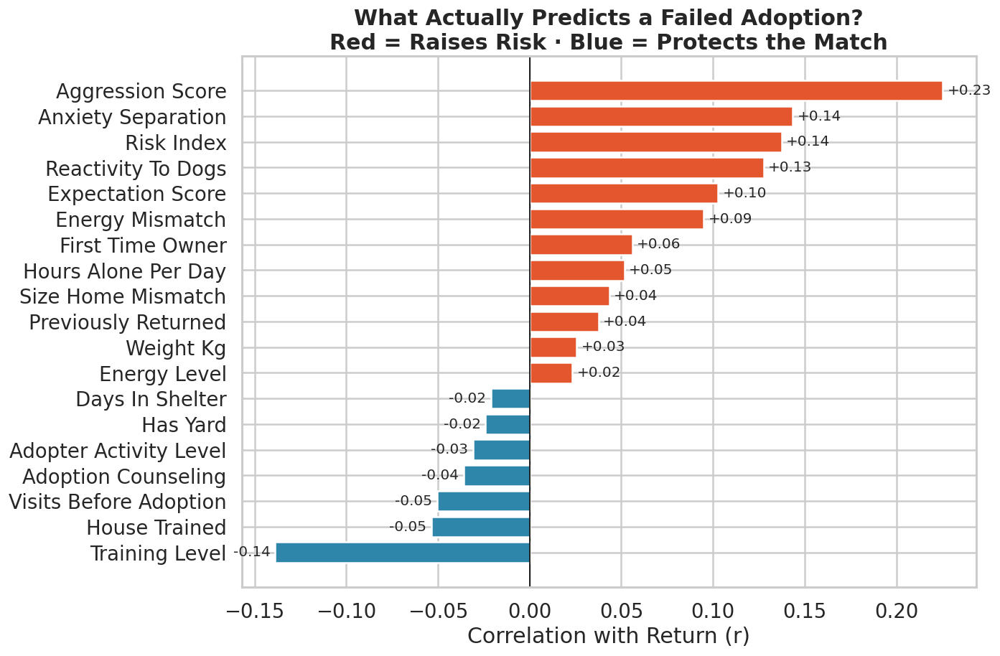
*Tornado Chart เปรียบเทียบปัจจัยเสี่ยง (สีส้ม) และปัจจัยปกป้อง (สีน้ำเงิน)* และ `assets/charts/12_risk_factor_summary.png`

> **บทพูดผู้บรรยาย (Speaker Script)**:  
> "สไลด์นี้รวบรวมตัวแปรทั้งหมดมาเปรียบเทียบในรูปแบบ Tornado Chart เพื่อให้เห็นภาพสรุปชัดเจน ฝั่งสีส้มคือปัจจัยที่เพิ่มความเสี่ยงส่งคืน นำโดยความก้าวร้าว ความวิตกกังวล และความคาดหวังที่ผิด ส่วนฝั่งสีน้ำเงินคือ 'เกราะคุ้มกัน' ที่ช่วยให้การรับเลี้ยงสำเร็จ ซึ่งสิ่งที่โดดเด่นที่สุดคือ 'Training Level' หรือระดับการฝึกอบรมสุนัข ตามมาด้วยการฝึกขับถ่าย และจำนวนครั้งที่มาเยี่ยมชม ชาร์ตนี้จึงเป็นเหมือนเข็มทิศบอกเราว่า ควรมุ่งเน้นทรัพยากรไปจัดการที่จุดใดเพื่อให้เกิดผลลัพธ์สูงสุดครับ"

---

## Slide 11: ยุทธศาสตร์ 3 ระยะเพื่อหยุดการส่งคืน (3-Phase Strategic Recommendations)
- **หัวข้อ**: แผนปฏิบัติการ 3 ระยะ: ยกระดับอัตราความสำเร็จสู่ >92%
- **กรอบการดำเนินงานเชิงกลยุทธ์ (Strategic Action Plan)**:

```
+-----------------------------------------------------------------------------------+
|  ระยะที่ 1: Pre-Adoption (การคัดกรองและเตรียมตัว)                                      |
|  - บังคับ Meet & Greet กับสัตว์เลี้ยงเดิม เพื่อตัดปัญหาข้อที่ 1 (ลดลง 22%)             |
|  - กฎการเยี่ยมอย่างน้อย 2-3 ครั้ง (Minimum 2-3 Visits Rule)                           |
|  - Reality-Check Counselling ปรับจูนความคาดหวังให้สมจริง                              |
|  - ระบบ Matching พลังงานสุนัขและขนาดตัวกับพื้นที่พักอาศัย                              |
+-----------------------------------------------------------------------------------+
                                          |
                                          v
+-----------------------------------------------------------------------------------+
|  ระยะที่ 2: Shelter Intervention (การเตรียมความพร้อมตัวสุนัข)                          |
|  - Targeted Behavior Rehab: ฝึกอบรมลดพฤติกรรมก้าวร้าวและวิตกกังวล                       |
|  - Basic Obedience & House-Training ก่อนส่งมอบสุนัข (เพิ่มอัตราสำเร็จทันที)            |
|  - ติดป้ายสัญญานเตือน (Flagging System) สุนัขที่มีปัญหา 2 ด้านขึ้นไป                   |
+-----------------------------------------------------------------------------------+
                                          |
                                          v
+-----------------------------------------------------------------------------------+
|  ระยะที่ 3: Post-Adoption Support (การดูแลในช่วงสัปดาห์ชี้ชะตา 14 วันแรก)             |
|  - 48-Hour & 7-Day Crisis Check-in: โทรติดตามผลใน 7 วันแรกที่มีมัธยฐานการส่งคืน         |
|  - ฟรีบริการปรึกษาครูฝึกสุนัข (Trainer Hotline) ใน 14 วันแรก                            |
|  - ชุมชนช่วยเหลือผู้รับเลี้ยง (Peer Support Group) สำหรับผู้รับเลี้ยงมือใหม่           |
+-----------------------------------------------------------------------------------+
```

- **ผลลัพธ์ที่คาดหวัง (Expected Impact)**:
  - ลดอัตราการส่งคืนจาก **15.0% เหลือต่ำกว่า 8.0%**
  - ช่วยรักษาสุนัขให้อยู่ในบ้านใหม่ถาวรได้เพิ่มขึ้นกว่า **2,500 – 3,000 ตัวต่อปี**

> **บทพูดผู้บรรยาย (Speaker Script)**:  
> "จากข้อค้นพบทั้งหมด เราขอเสนอยุทธศาสตร์ 3 ระยะที่เป็นรูปธรรมครับ ระยะแรกคือ 'ก่อนรับเลี้ยง' เราต้องกำหนดให้มี Meet & Greet สัตว์เลี้ยงเดิม เยี่ยมชมอย่างน้อย 2-3 ครั้ง และให้คำปรึกษาปรับความคาดหวัง ระยะที่สอง 'ในสถานสงเคราะห์' ต้องลงทุนกับการฝึกพฤติกรรมพื้นฐาน เพราะนี่คือเกราะคุ้มกันที่ดีที่สุด และระยะที่สาม 'หลังรับเลี้ยง 14 วันแรก' เนื่องจากมัธยฐานการส่งคืนคือวันที่ 7 เราต้องมีระบบโทรเช็กและสายด่วนครูฝึกคอยช่วยเหลือฉุกเฉินในสัปดาห์แรก หากเราทำครบทั้ง 3 ระยะนี้ เราจะลดอัตราการส่งคืนลงได้เกือบครึ่งหนึ่ง ช่วยชีวิตสุนัขได้นับพันตัวครับ"

---

## Slide 12: บทสรุปและประเด็นปิดท้าย (Conclusion & Takeaways)
- **หัวข้อ**: บทสรุป: การรับเลี้ยงสุนัขคือพันธสัญญาแห่งความพร้อม
- **3 ข้อคิดสำคัญ (Key Takeaways)**:
  1. **"It's about Matching, Not Charity"**: ความสำเร็จไม่ได้ขึ้นกับความสงสาร แต่ขึ้นกับความเข้ากันได้ของวิถีชีวิตและพื้นที่
  2. **"Expectations Beat Experience"**: คนเลี้ยงมือใหม่ประสบความสำเร็จได้สูงมาก เพียงแค่เข้าใจและเตรียมใจรับความจริง
  3. **"Training & 7-Day Window Save Lives"**: การฝึกฝนสุนัขล่วงหน้า และการประคับประคองผู้เลี้ยงใน 7-14 วันแรก คือหัวใจสำคัญของการหยุดวงจรการส่งคืน
- **Call to Action**: *"เปลี่ยนการรับเลี้ยงสุนัข จากการเสี่ยงโชค ให้เป็นวิทยาศาสตร์ที่นำพาความสุขมาสู่ทั้งคนและสัตว์อย่างแท้จริง"*
- **ช่วงถาม-ตอบ (Q&A Session)**: เปิดรับข้อซักถามจากผู้ร่วมประชุม

> **บทพูดผู้บรรยาย (Speaker Script)**:  
> "สุดท้ายนี้ สุนัขทุกตัวสมควรได้รับบ้านที่อบอุ่นและถาวร ข้อมูล 42,000 เคสนี้สอนเราว่า การส่งคืนสุนัขไม่ใช่ความล้มเหลวที่แก้ไขไม่ได้ หากเราเปลี่ยนผ่านจากการส่งมอบด้วยความรู้สึก มาเป็นการคัดกรองด้วยข้อมูลวิทยาศาสตร์ จับคู่พลังงาน ปรับความคาดหวัง และยืนเคียงข้างผู้เลี้ยงในสัปดาห์แรก เราจะสามารถเปลี่ยนสถิติ 1 ใน 7 ตัวที่ถูกทอดทิ้ง ให้กลายเป็น 7 ใน 7 ตัวที่ได้บ้านที่อบอุ่นตลอดไปครับ ขอบคุณทุกท่านมากครับ"

---

## Slide 13: หน้าสรุปผลการวิเคราะห์และข้อเสนอแนะ (Executive Summary Dashboard)
- **หัวข้อ**: หน้าสรุปผล: ถอดรหัสปัจจัยความสำเร็จและแนวทางแก้ไข 42,000 เคส
- **หัวข้อย่อย**: รวบรวมตัวเลขชี้ขาด ปัญหาต้นตอ และกุญแจสำคัญสู่การรับเลี้ยงสุนัขที่ยั่งยืน
- **4 เสาหลักสรุปผล (4 Key Pillars)**:
  1. **ภาพรวมสถิติ (Scale & Outcome)**:
     - รับเลี้ยงสำเร็จ **85.0%** (35,703 ตัว) | ถูกส่งคืน **15.0%** (6,297 ตัว) หรือ 1 ใน 7 ตัว
     - จุดวิกฤตสูงสุด: มัธยฐานการส่งคืนอยู่ที่ **7 วันแรก** (Critical Window)
  2. **ต้นตอความล้มเหลว (Top Root Causes >71%)**:
     - ปัญหาพฤติกรรมและความขัดแย้งคิดเป็น **70.9%** (เข้ากับหมาเดิมไม่ได้ 22%, ดุร้าย 21.5%, วิตกกังวล 15.5%, คาดหวังเกินจริง 11.9%)
     - ปัญหาภูมิแพ้ (3.8%) และสุขภาพ (5.0%) เป็นเพียงส่วนน้อย
  3. **ตัวคูณความเสี่ยง (Risk Multipliers)**:
     - สุนัขที่มีพฤติกรรมเสี่ยง 3 ด้านพร้อมกัน อัตราส่งคืนแตะ **40.2%**
     - สุนัขดุร้ายและไม่ได้รับการฝึก ส่งคืนสูงถึง **47.1%**
     - หมาพลังงานสูง-เจ้าของไม่ออกกำลังกาย ส่งคืน **21.2%** | คอนโดหมาใหญ่ ส่งคืน **19.5%**
  4. **ปัจจัยปกป้องและสร้างความสำเร็จ (Success Enablers)**:
     - **การฝึกสุนัข (Training Level):** ลดอัตราการส่งคืนได้ถึง **17.5 pp** (เหลือ 29.6%)
     - **การเตรียมตัวล่วงหน้า:** เยี่ยมชม ≥4 ครั้ง ลดการส่งคืนเหลือเพียง **10.9%**
     - **ความคาดหวังตามจริง:** มือใหม่หัดเลี้ยงที่มองโลกตามจริง ส่งคืนต่ำมากเพียง **9.4%** (ชนะมือเก๋าที่คาดหวังเกินจริง 16.6%)
- **เมทริกซ์สรุป 3 คำตอบสำคัญ**:
  - *ทำไมถึงสำเร็จ?* ➔ สุนัขผ่านการฝึกอบรม + เจ้าของมีความคาดหวังสมจริง + มาเยี่ยมดูใจหลายครั้ง + ไลฟ์สไตล์ตรงกัน
  - *ทำไมถึงล้มเหลว?* ➔ สัตว์เลี้ยงเดิมเข้ากันไม่ได้ + ความก้าวร้าวปะทุใน 7 วันแรก + ปล่อยอยู่ลำพังนาน + คาดหวังเพอร์เฟกต์
  - *แผนปฏิบัติการเร่งด่วน?* ➔ กฎ Meet & Greet ก่อนรับ + เชลเตอร์ฝึกพฤติกรรมพื้นฐาน + สายด่วนประกบ 14 วันแรก (เป้าหมายลดส่งคืนสู่ <8%)
- **สาระสำคัญปิดท้าย**: *"ความสำเร็จของการรับเลี้ยงสุนัขไม่ใช่เรื่องโชคชะตา แต่คือวิทยาศาสตร์ของการจับคู่ที่เหมาะสม การฝึกสุนัขล่วงหน้า และการเคียงข้างเจ้าของใน 14 วันแรก"*

> **บทพูดผู้บรรยาย (Speaker Script)**:  
> "สไลด์นี้คือหน้าสรุปผลรวบยอดทั้งหมดของการศึกษา 42,000 เคสครับ ฝั่งตัวเลขหลักชี้ว่า แม้เราจะสำเร็จถึง 85% แต่ช่องว่าง 15% หรือ 6,297 ตัวที่ถูกส่งคืน มีจุดวิกฤตอยู่ที่ 7 วันแรก และกว่า 71% เกิดจากพฤติกรรมและความขัดแย้ง ไม่ใช่เรื่องแพ้ขนหรือหมาป่วย ปัญหาพฤติกรรมจะทวีคูณความเสี่ยงขึ้นเป็น 40% ถ้ามีครบ 3 ด้าน แต่ข่าวดีคือ 'เราป้องกันได้' ด้วยการฝึกสุนัขซึ่งลดการส่งคืนได้ถึง 17.5% การมาเยี่ยมชม 4 ครั้งลดการส่งคืนเหลือ 10.9% และการปรับความคาดหวังให้สมจริง หากเรานำยุทธศาสตร์ 3 ระยะไปปฏิบัติจริง เราจะสามารถลดอัตราการส่งคืนลงครึ่งหนึ่ง และเปลี่ยนสุนัข 1 ใน 7 ตัวที่เคยถูกทอดทิ้ง ให้ได้อยู่ในบ้านที่อบอุ่นตลอดไปครับ ขอบคุณทุกท่านมากครับ และขอเปิดรับคำถามครับ"
